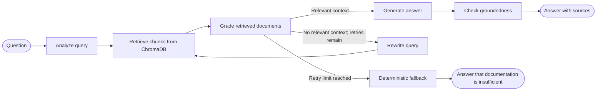

# Self-Corrective RAG with LangGraph

Ask questions about technical documentation and get answers grounded in retrieved sources. A **LangGraph state graph** orchestrates retrieval, relevance checks, query rewriting, answer generation, and a final groundedness check.

The project includes a small FastAPI web/API layer and a browser UI for running the graph and inspecting its execution trace. FastAPI is the interface; **LangGraph is the RAG workflow engine**.

## See the graph



`apps/graph/workflow.py` builds and compiles the `StateGraph`. Each node reads and updates `RAGState`; conditional routing sends the workflow to generation, another retrieval attempt, or fallback. The retry limit is currently two.

## Start locally

### Requirements

- Python 3.11 or newer
- A Google Gemini API key

### Install and configure

```powershell
git clone <repo-url>
cd self-corrective-rag
python -m venv .venv
.\.venv\Scripts\Activate.ps1
pip install -r requirements.txt
Copy-Item .env.example .env
```

Add your Gemini API key to `.env`:

```ini
GEMINI_API_KEY=your_gemini_api_key_here
GEMINI_MODEL=gemini-3.8-flash
```

### Index the documentation

The default corpus is the set of Markdown guides in `docs/`. Build or refresh their embeddings in the local ChromaDB collection:

```powershell
python -m apps.ingestion.vectorstore
```

The embedding model (`all-MiniLM-L6-v2`) may need to be downloaded the first time it is used. ChromaDB data is stored in `chroma_db/`.

### Run the web app

```powershell
uvicorn apps.main:app --reload
```

Open [http://localhost:8000](http://localhost:8000) for the Visual Pipeline UI. The interactive API reference is available at [http://localhost:8000/docs](http://localhost:8000/docs).

## Follow a question through the graph

1. **Analyze** — validate the question and initialize graph state.
2. **Retrieve** — embed the active search query and find up to five chunks in ChromaDB.
3. **Grade** — ask Gemini to evaluate whether each retrieved chunk can help answer the question; irrelevant chunks are excluded.
4. **Route** — continue to generation when relevant context exists, otherwise rewrite and retry while attempts remain.
5. **Rewrite** — use Gemini to produce a more useful search query, then return to retrieval.
6. **Generate** — answer using only the relevant chunks and preserve their source metadata.
7. **Check** — evaluate whether the generated answer is supported by its context.
8. **Fallback** — after retries are exhausted, return a fixed “I don't know” answer instead of guessing.

The UI displays the graph's actual execution trace, including retrieval attempts, document grades, rewritten queries, sources, and fallback status.

## Project map

| Path | Responsibility |
|---|---|
| `apps/graph/workflow.py` | LangGraph `StateGraph`, nodes, and conditional routing |
| `apps/graph/state.py` | Shared state passed between graph nodes |
| `apps/graph/nodes.py` | Query analysis, retrieval, grading, rewriting, generation, and fallback logic |
| `apps/graph/schemas.py` | Structured Gemini response schemas |
| `apps/ingestion/loader.py` | Load Markdown files from `docs/` |
| `apps/ingestion/chunker.py` | Split documents while preserving code blocks where possible |
| `apps/ingestion/vectorstore.py` | Sentence Transformer embeddings and persistent ChromaDB operations |
| `apps/llm/client.py` | Gemini client and structured/text generation |
| `apps/api/routes.py` | HTTP endpoints that invoke the graph and support document ingestion |
| `apps/main.py` | FastAPI app, static UI, and health check |
| `frontend/` | Browser-based RAG pipeline and ingestion interface |
| `docs/` | Default source documentation corpus |

## Knowledge and retrieval

- **Chunking:** Markdown and prose are split into manageable sections; code fences are kept together when possible.
- **Embeddings:** `sentence-transformers/all-MiniLM-L6-v2` creates local 384-dimensional embeddings.
- **Vector search:** ChromaDB persists vectors in `chroma_db/` and ranks with cosine distance.
- **Metadata:** Chunks carry a source name, title, URL (when available), and chunk ID for citations.
- **LLM:** Google Gemini grades documents, rewrites queries, generates answers, and checks groundedness using structured outputs where applicable.

To add default-corpus documentation, place a Markdown file in `docs/` and rerun ingestion. You can also add raw text, a Markdown file, or a URL through the UI or the ingestion endpoint.

## HTTP interface

The API router is mounted with and without the `/api` prefix, so its routes are available both ways (for example, `/query` and `/api/query`). The health check is available at `/health`.

| Method | Route | Purpose |
|---|---|---|
| `POST` | `/query` | Run the LangGraph workflow for a question and return the answer, citations, and execution details |
| `POST` | `/ingest` | Index the default `docs/` corpus, a URL, raw text, or a multipart file |
| `GET` | `/documents` | List indexed sources and chunk counts |
| `POST` | `/feedback` | Record a 1–5 rating and optional feedback in memory |
| `GET` | `/health` | Return the application health status |

Example request:

```bash
curl -X POST http://localhost:8000/query \
  -H "Content-Type: application/json" \
  -d "{\"question\":\"How do conditional edges route execution in LangGraph?\"}"
```

The response includes `answer`, `sources`, and `execution`. The execution details include retrieval results, document grades, retry count, and the graph trace. Feedback is currently stored in process memory and is lost when the server restarts.

## Configuration and implementation notes

| Setting | Default | Description |
|---|---|---|
| `GEMINI_API_KEY` | — | Required credential for Gemini |
| `GEMINI_MODEL` | `gemini-3.8-flash` | Gemini model used by the LLM client |
| Maximum query rewrites | `2` | Retry limit initialized in the graph's query-analysis node |
| Retrieval candidates | `5` | Maximum chunks retrieved per attempt |

The Gemini client uses a timeout and retries selected transient failures. The embedding model is cached for the process and first attempts to load from the local model cache.

## Try these questions

- “What are state, nodes, and edges in LangGraph?”
- “How do conditional edges and loops work in LangGraph?”
- “How can I deploy a Django application on AWS?”

The first questions should exercise retrieval and grounded generation when matching content exists. The unrelated question demonstrates query rewriting and the deterministic fallback when the indexed documentation cannot answer it.

## Extend the workflow

- Add or change behavior by implementing a node in `apps/graph/nodes.py` and wiring it in `apps/graph/workflow.py`.
- Update `RAGState` when a node needs to pass additional state to other nodes.
- Add Markdown sources under `docs/`, then rerun the ingestion command.
- Use the UI or `POST /ingest` to add supplemental content without changing the default corpus.

The graph is compiled as `rag_graph` and invoked by the HTTP route with the question as its initial state.
